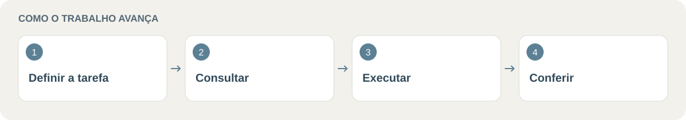

<p align="center">
  
</p>

<p align="center">


</p>

# 🧠 consultor-primeiro

> **Um consultor define a abordagem; agentes executam; o principal confere.** Skill para Claude Code, com exemplos jurídicos e técnicos.

Criado por **[Lucas Barkoski](https://github.com/Barkoski)**.

**Explore:** [📚 Documentação](#documentacao) · [⚡ Como usar](#secao-1) · [📑 Exemplos (escolha sua aba)](#secao-2) · [🧩 Quem faz o quê](#secao-3) · [📥 Instalação](#secao-4)

<p align="center">
  
</p>

<a id="secao-1"></a>
## ⚡ Como usar

Digite `/consultor-primeiro` e, na frente, escreva o que você quer, com suas palavras:

```
/consultor-primeiro <diga aqui a tarefa, onde estão os arquivos e o resultado que você quer>
```

É só isso. O contexto da sua frase define o que ele faz.

---

<a id="secao-2"></a>
## 📑 Exemplos (escolha sua aba)

<details open>
<summary><h3>⚖️ Aba 1: Jurídico</h3></summary>

**1. Analisar um processo**
```
/consultor-primeiro Analise o processo em C:\Casos\caso-001\autos.pdf (aposentadoria por
tempo de contribuição, indeferida pelo INSS). Quero: cronologia dos fatos, requisitos
atendidos e não atendidos, provas que faltam, pontos fracos da tese e o contra-argumento
provável do INSS. Cite a página de cada informação. Se faltar dado, diga "não consta".
```

**2. Processo administrativo: prazos e pendências**
```
/consultor-primeiro Analise este processo administrativo e me dê os prazos e as exigências
pendentes, com a fonte de cada item.
```

**3. Redigir uma minuta**
```
/consultor-primeiro Com base na análise acima, redija uma minuta de petição inicial para eu
revisar. Marque com [VERIFICAR] o que depender de confirmação minha.
```

**4. Revisar uma peça e achar os pontos fracos**
```
/consultor-primeiro Revise a petição em C:\Casos\caso-001\peticao.docx. Aponte os pontos
fracos e o contra-argumento provável do INSS ou do juízo.
```

**O que acontece por trás:** o consultor define a abordagem; os executores necessários recebem tarefas delimitadas; o principal confere o resultado. O consultor também pode executar quando isso for mais adequado. A conferência não substitui a revisão do advogado.

> ⚠️ **Sigilo:** o que você envia é processado na nuvem do serviço do Claude. Use dados anonimizados, ou apenas o que você decidiu conscientemente que pode ser processado.
> ⚠️ **Tudo é minuta** para revisão do advogado. Confira as fontes.

</details>

<details open>
<summary><h3>💻 Aba 2: Fora do jurídico</h3></summary>

**1. Consertar um erro em um programa**
```
/consultor-primeiro Corrija o erro de login em C:\projetos\meu-app. O erro é "401 ao renovar
o token". Já tentei limpar o cache. Rode os testes no fim e diga o que não foi verificado.
```

**2. Planejar um projeto (só o plano, sem construir)**
```
/consultor-primeiro Projete um pipeline de agentes com 2 orquestradores, 1 revisor e 12
modelos locais. Entregue só a especificação.
```

**3. Organizar e resumir documentos**
```
/consultor-primeiro Leia os arquivos da pasta C:\Docs\contratos, liste em uma tabela o
vencimento e o valor de cada contrato e destaque os que vencem em 90 dias.
```

**4. Pesquisar e comparar opções**
```
/consultor-primeiro Compare 3 opções de hospedagem para um site de escritório, com custo,
vantagens e riscos. Recomende uma e explique por quê.
```

**5. Automatizar uma rotina**
```
/consultor-primeiro Crie um script que renomeie os PDFs da pasta C:\Entrada pelo padrão
AAAA-MM-DD_nome.pdf. Teste com 3 arquivos de exemplo antes de me entregar.
```

</details>

---

<a id="secao-3"></a>
## 🧩 Quem faz o quê

| Quem | Papel | Modelo | Ferramentas |
|---|---|---|---|
| 🧠 **consultor** (agente master) | Diagnóstico, estratégia e tarefas para delegar; executa quando julga necessário | Fable, se o seu plano liberar; senão Opus | Read, Grep, Glob, Bash, Edit, Write |
| 🛠️ **trabalhador** | Implementa, testa, corrige e redige | Sonnet | Read, Grep, Glob, Bash, Edit, Write |
| 🔎 **tarefa-simples** | Busca, lista, conta e organiza (só leitura) | Haiku | Read, Grep, Glob, Bash |
| 🎛️ **principal** (o próprio Claude) | Monta o briefing, distribui, confere e entrega | o da sua sessão | — |

A skill tenta o Fable e, se o plano não liberar, repete com o Opus. Arquivos: `skills/consultor-primeiro/SKILL.md` e `agents/*.md`.

<a id="secao-4"></a>
## 📥 Instalação

### Sem terminal (recomendado)

1. Nesta página do GitHub, clique em **Code → Download ZIP** e extraia.
2. Abra `C:\Users\<seu usuário>\.claude\` no Explorador de Arquivos (cole `%USERPROFILE%\.claude` na barra de endereço).
3. Copie a pasta `skills\consultor-primeiro` para dentro de `.claude\skills\` e os três arquivos de `agents\` para dentro de `.claude\agents\` (crie as pastas se não existirem).
4. Abra uma sessão nova do Claude Code.

Se já houver arquivos com os mesmos nomes, guarde uma cópia antes de sobrescrever.

### Com o script

Clique com o botão direito em `install.ps1` → **Executar com o PowerShell**, ou rode:

```powershell
powershell -NoProfile -ExecutionPolicy Bypass -File .\install.ps1
```

O script copia os arquivos para `~\.claude\` e, antes de sobrescrever, salva os existentes em `~\.claude\backup-consultor-<data-hora>\`. O bypass vale só para esse comando.

<a id="secao-5"></a>
## 💡 Dicas

- Diga o **objetivo**, onde estão os **arquivos**, as **restrições** e o **formato** do resultado (relatório, tabela, código, minuta).
- Em tarefas de projeto, o resultado é uma especificação em Markdown; a construção só começa depois que você aprova.

<a id="secao-6"></a>
## 🚫 Quando não usar

A skill **sempre** consulta o agente master (Fable ou Opus) antes de executar. Em tarefas triviais (renomear um arquivo, responder uma pergunta curta) isso custa mais do que fazer direto. Use-a para trabalho médio ou grande. A skill não mede nem garante economia.

<a id="secao-7"></a>
## 🔒 Sigilo e limitações

- Os subagentes rodam no mesmo serviço do Claude Code, na nuvem. As regras de sigilo do texto são instruções ao modelo, não uma barreira técnica: **não cole dados de clientes ou segredos** sem decidir conscientemente que podem ser processados.
- A skill pede que o modelo cite fonte, não invente fatos e trate peças como minutas. Isso reduz erros, mas não os elimina: confira sempre.
- O agente `consultor` também pode ser acionado fora da skill, pela descrição dele (falha repetida, decisão de arquitetura). Se quiser só a invocação explícita, apague a segunda frase da `description` dele.
- A skill só deve disparar quando você a invoca. A restrição está na `description`. Para travar tecnicamente, acrescente `disable-model-invocation: true` ao frontmatter da skill e confirme que `/consultor-primeiro` ainda funciona no seu aplicativo.
- A seção "Regras de segurança" da skill traz um padrão voltado a trabalho jurídico (não inventar, sigilo, minuta). Edite-a para o seu contexto.
- Modelos: aliases `fable`, `opus`, `sonnet` e `haiku`, que precisam estar disponíveis no seu plano.


<a id="documentacao"></a>
## 📚 Links para continuar

- [Fluxo da skill](skills/consultor-primeiro/SKILL.md)
- [Consultor](agents/consultor.md)
- [Trabalhador](agents/trabalhador.md)
- [Tarefa simples](agents/tarefa-simples.md)
- [Instalador com backup](install.ps1)


<a id="secao-8"></a>
## 📄 Licença

MIT. Veja `LICENSE`.
